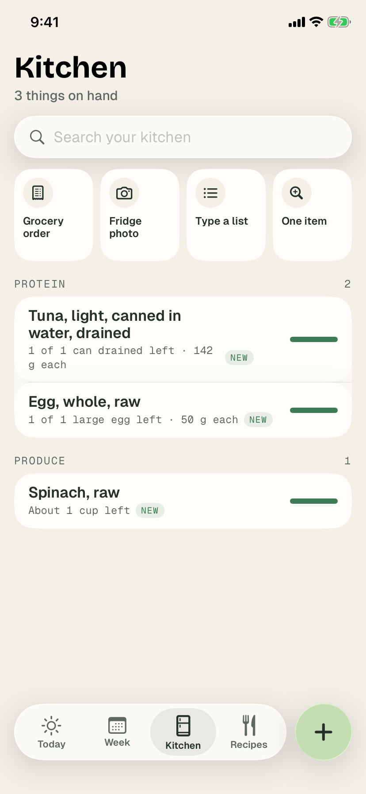
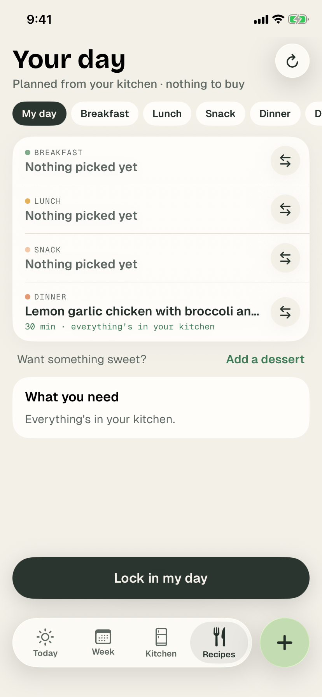
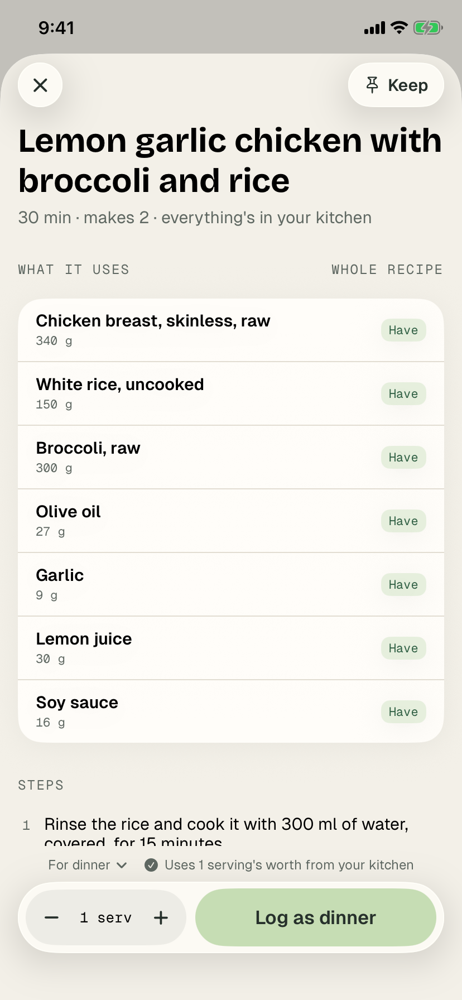
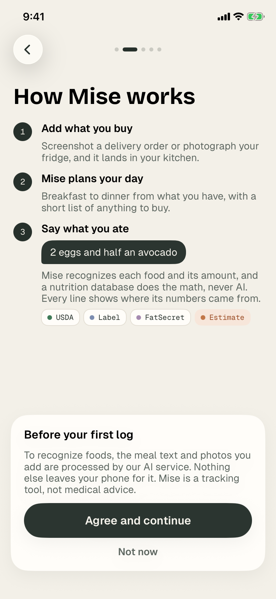
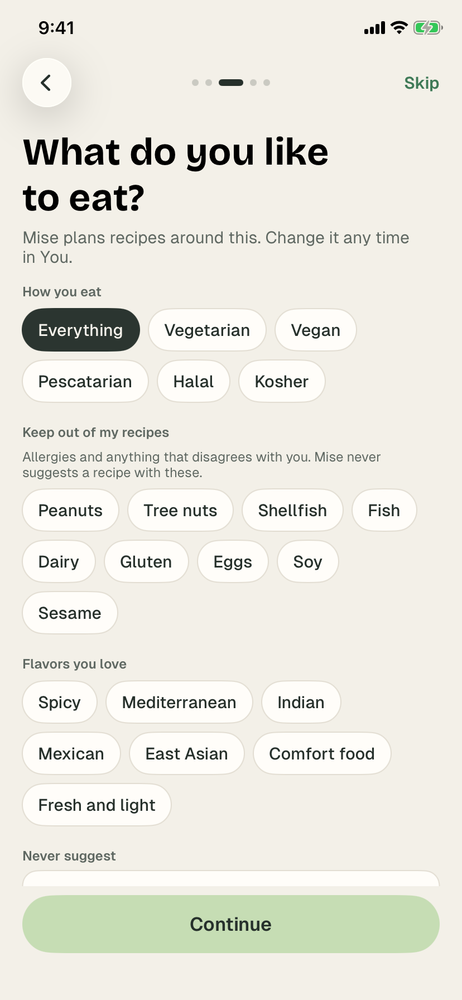
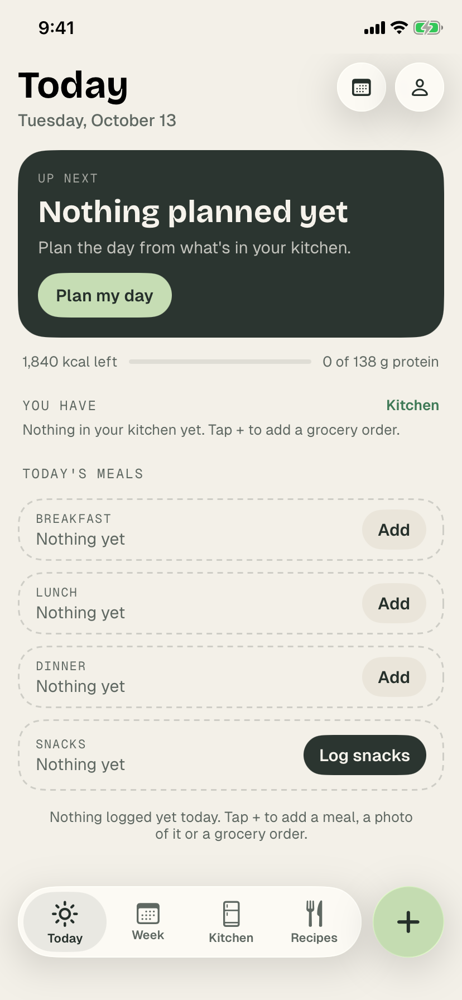
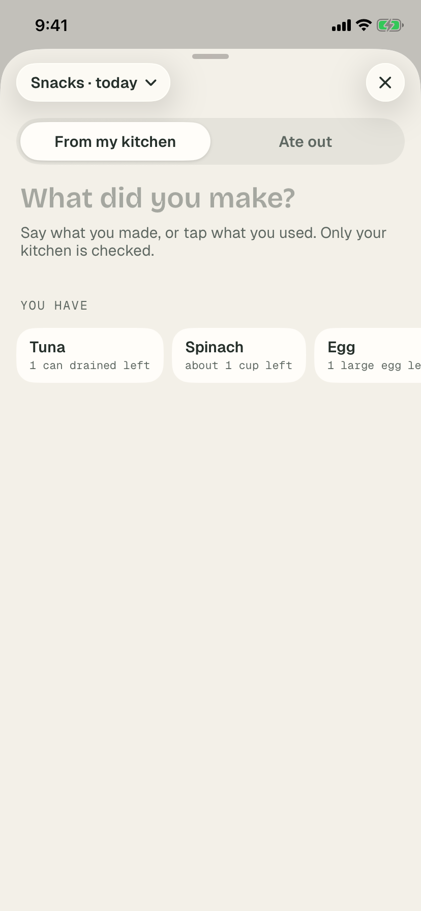
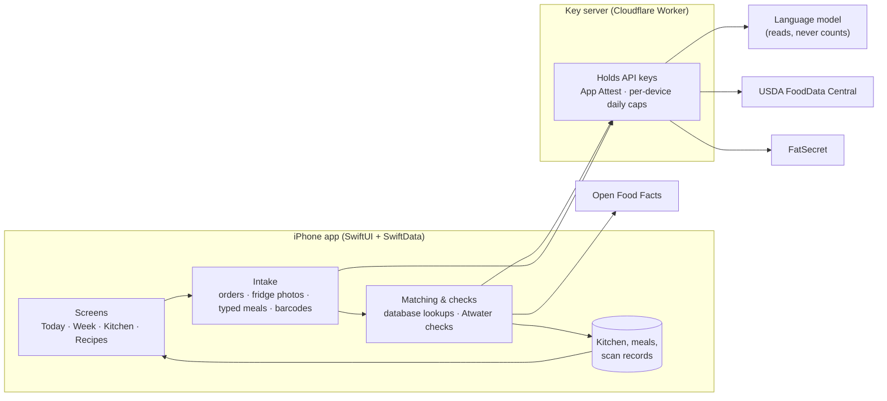

  
  
  

# Mise: your kitchen on your phone

Mise is an iOS app that helps people stop having to think about food, so they can focus on making it and eating it. It keeps track of **what you have, what you need, and how much you have left**, then plans your day around it.

- **Add what you buy.** Screenshot a grocery delivery order or photograph your fridge, and every item lands in your kitchen in the units you bought it in ("4 of 4 cans left").
- **Mise plans your day.** Breakfast to dinner from what's already in your kitchen, built around your tastes and anything you keep out of your recipes, with a short list of anything to buy.
- **Say what you ate.** Type "2 eggs and half an avocado", tap what you used from your kitchen, or log a meal you ate out. Your kitchen updates as you go.

> This repository is a showcase. The app's source is private; what's here is a write-up of how it's built, screenshots, and a few representative code excerpts.

## Screenshots

| How it works | Your tastes | Today | Kitchen |
|---|---|---|---|
|  |  |  |  |

| Log from your kitchen | Your day | Recipe |
|---|---|---|
|  |  |  |

## Accuracy is the product

Mise tells people what is going into their bodies, so wrong numbers are the worst bug it can have. The app is built around one rule: **the AI never supplies a nutrition number.** A language model reads what you bought or ate and estimates amounts; the numbers always come from a nutrition database, and every line says which one.

| Source | Where the numbers come from |
|---|---|
| **USDA** | A bundled table of common foods, plus live search of USDA FoodData Central |
| **Label** | A product's Nutrition Facts, found by barcode or read from the package and checked for consistency |
| **FatSecret** | The FatSecret Platform database, for branded and restaurant foods USDA doesn't have |
| **Estimate** | Anything else. Flagged on every screen until it's matched |

Safeguards around that rule:

- **Consistency checks.** Label readings and estimates are checked against the Atwater factors (4 kcal/g protein and net carbs, 9 kcal/g fat), so a misread "40" for "140" is caught before it's saved. Values from outside sources must also pass plausibility bounds.
- **Nothing silently disappears.** If one item in a 30-item order can't be matched, the rest still land in your kitchen; the miss is flagged with a one-tap retry and the real error is recorded, never quietly shown as "no match".
- **An eval suite, not vibes.** A fixed set of real typed meals and real grocery order screenshots, each with the answer Mise should produce, runs end to end against the live AI and databases and is scored on foods, amounts and numbers. A batch eval gates every TestFlight build, and latency changes are checked against it so speed is never traded for accuracy.
- **A record of every scan.** Each scan keeps an on-device record of the input, what the AI read, each match decision, and per-step timings, so any wrong answer can be traced to the step that caused it.

## Architecture

- **App.** Swift and SwiftUI on iOS 17+, with SwiftData for storage. About 20,000 lines across models, services and views.
- **Intake.** Order screenshots are read in parallel, one reader per screenshot with its neighbours as context, so long orders aren't slower than short ones. Items go into the kitchen as *pending* the moment they're read and fill in as lookups finish.
- **Networking.** Every database lookup goes through one layer that caps concurrent requests, caches good answers on disk, retries only transient failures with backoff, honours cancellation, and records timing for a built-in speed log.
- **Key server.** A small Cloudflare Worker holds every API key, so no key ships in the app. It accepts only the requests the app actually makes, verifies the device with Apple App Attest, and enforces per-device daily caps and a daily spending cap.
- **Privacy.** Data stays on the phone except what a lookup needs. Export and delete-everything cover every store, including the lookup cache, since the queries say what you buy.

## Design system

The visual language is "Oat and Sage": warm off-white pages, sage for the one "do this next" action on each screen, and a "Market" palette (sage, apricot, honey) shared by the logo and the macro colours. Controls that float over content use iOS 26 Liquid Glass, with a frosted fallback on earlier versions. Type is three bundled families: Bricolage Grotesque for titles and numbers, Geist for reading, and Geist Mono for amounts and sources. Every colour is defined for light and dark mode.

The logo is three prep bowls seen from above, set out before cooking: *mise en place*. It's drawn in code, so it's crisp at every size.

See [`excerpts/DesignSystem`](excerpts/DesignSystem).

## Engineering practices

- **Tests.** Around 480 XCTest cases in the app and 120 in the key server. Every reported bug ships with a test built from the real example that found it.
- **Root causes, not special cases.** Fixes target the underlying cause; no food or brand is ever hard-coded to make a case pass.
- **CI on self-hosted Mac runners.** Unit tests, the live eval, key-server deploys, log archiving, a daily scorecard and TestFlight uploads all run in GitHub Actions on self-hosted macOS runners. Jobs keep the machine awake, record its health so a dropped job can be explained, and share one simulator at a time.
- **Simulator walkthroughs.** Automated runs drive the app through real user flows on the simulator and capture every screen (the screenshots here come from one).
- **Observability.** Server request logs are archived daily, and opted-in devices upload scan records for debugging, with 30-day retention.
- **Design first.** New screens are mocked up and approved before they're built.

## Code excerpts

A few files from the app, shared as samples. They're excerpts: they reference types that aren't included and won't build on their own.

| File | What it shows |
|---|---|
| [`DesignSystem/DesignSystem.swift`](excerpts/DesignSystem/DesignSystem.swift) | Colour tokens for light and dark, bundled fonts, Liquid Glass with a fallback, the logo, segmented control and button styles |
| [`DesignSystem/Components.swift`](excerpts/DesignSystem/Components.swift) | Source chips, macro line, progress bar, score ring, and a title row that reflows at large text sizes |
| [`Models/Nutrients.swift`](excerpts/Models/Nutrients.swift) | The nutrition value type, Atwater consistency and plausibility checks, display formatting, and the transparent recipe score |
| [`Tests/NutritionTests.swift`](excerpts/Tests/NutritionTests.swift) | Accuracy tests against USDA household portions |
| [`Tests/BowlsMarkTests.swift`](excerpts/Tests/BowlsMarkTests.swift) | A small geometry test for the logo |

## Tech stack

Swift · SwiftUI · SwiftData · XCTest · Vision and AVFoundation (camera and barcodes) · Cloudflare Workers · Apple App Attest · GitHub Actions on self-hosted macOS runners · TestFlight · USDA FoodData Central · FatSecret Platform · Open Food Facts

## License

Copyright © 2026 Namrita (@nperincherry1106). All rights reserved. The code excerpts are shared for viewing only.
